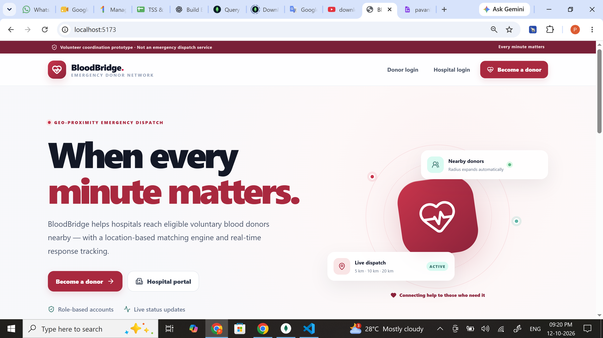
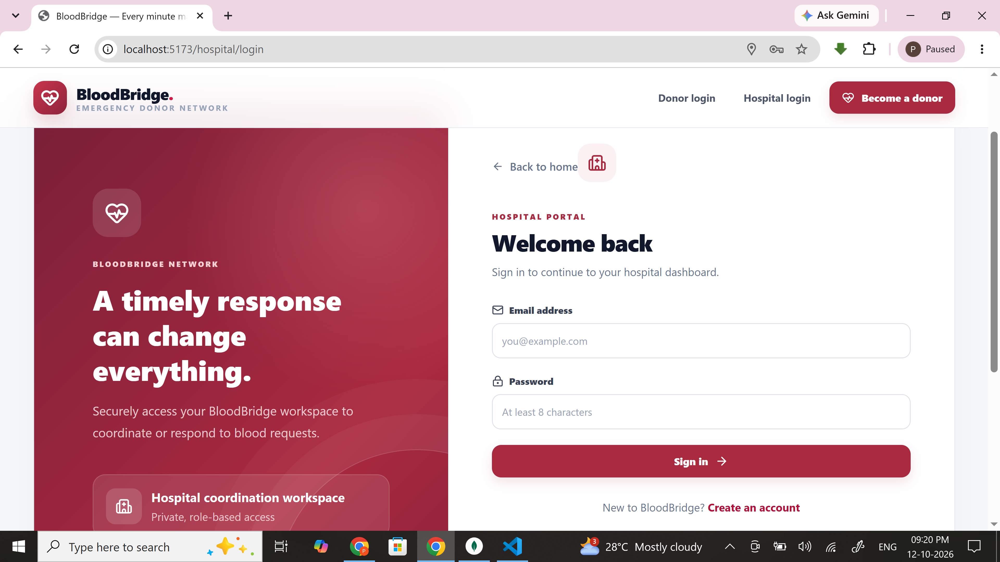
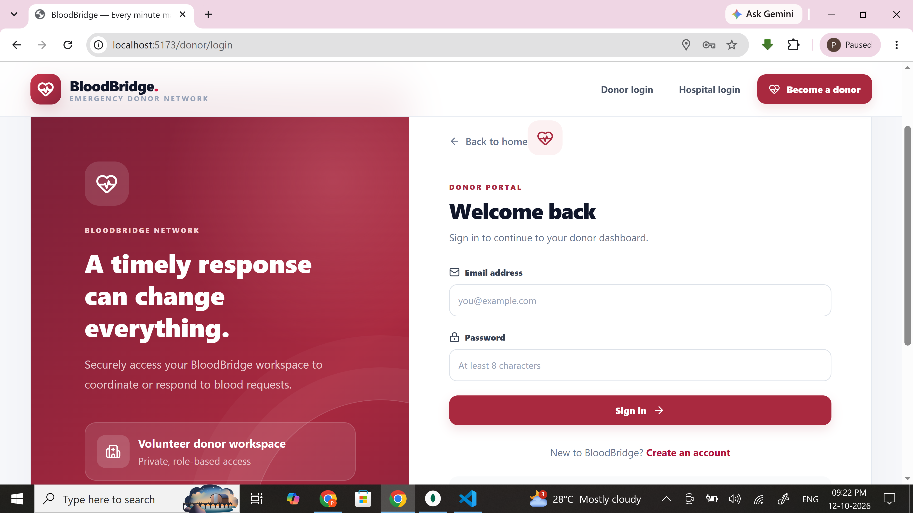
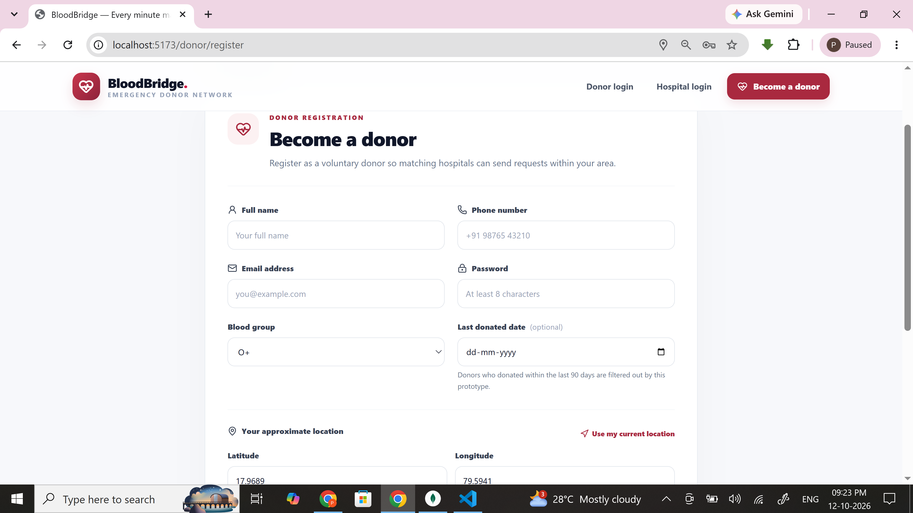
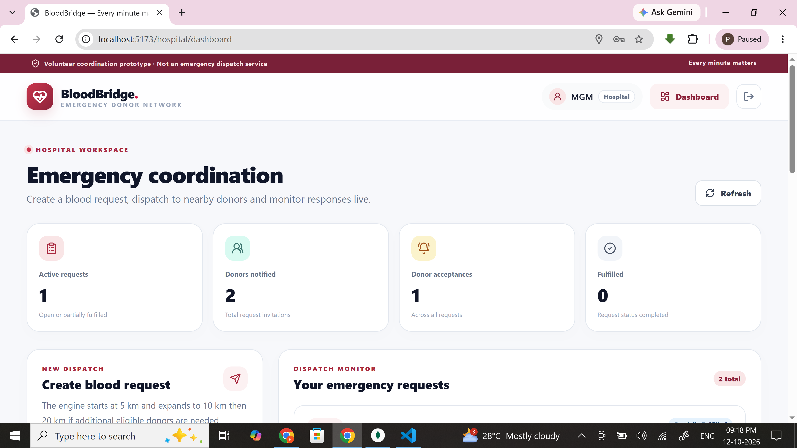
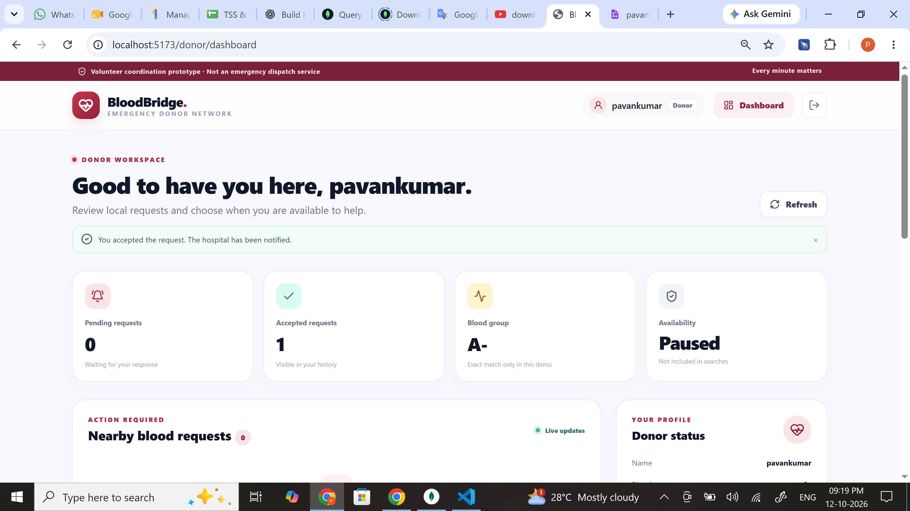
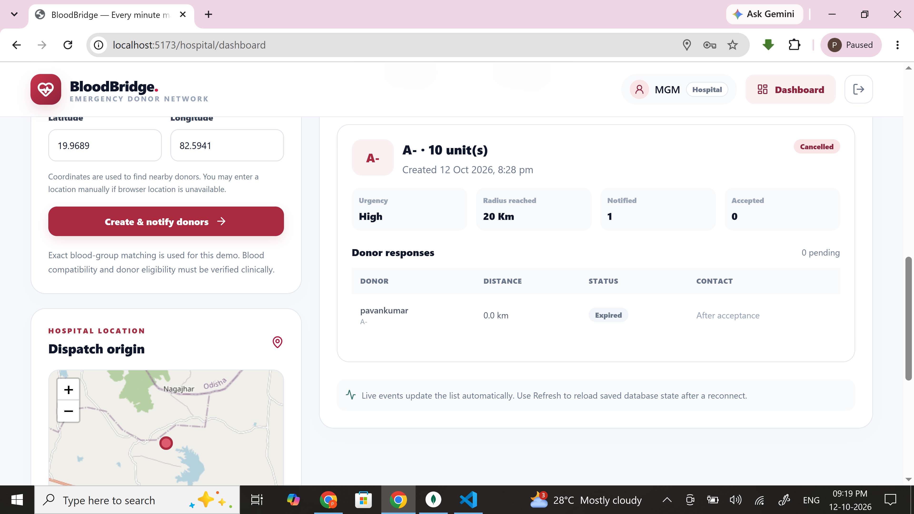
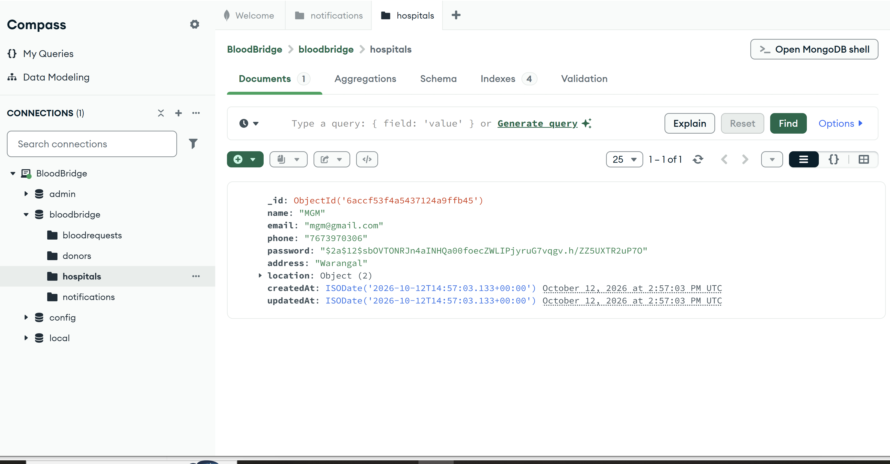

# BloodBridge — Screenshot Guide

This folder is where you store screenshots taken from your own running BloodBridge app. The screenshots are intentionally not pre-generated: use the actual pages and results from your local test run.

## Capture workflow (Windows)

1. Start MongoDB Community Server, the backend (`npm run dev` in `server/`), and the frontend (`npm run dev` in `client/`).
2. Open `http://localhost:5173` and use test donor and hospital accounts.
3. Press **Win + Shift + S**, select the app area, then save the image as a PNG in this folder.
4. Keep the browser zoom at 100%, make sure the important UI is visible, and avoid including unrelated windows or the browser developer console unless it is specifically relevant.
5. Use fake test data. Mask personal phone numbers, email addresses, JWTs, authorization headers, and secrets. Never screenshot the contents of `.env`.
6. Use the filenames below so the gallery Markdown works without changes.

## Recommended screenshots

| Filename | What to capture |
|---|---|
| `01-landing-page.png` | Landing page and role selection |
| `02-donor-registration.png` | Donor form with sample blood group and location (no real contact details) |
| `03-donor-dashboard.png` | Donor dashboard and an incoming request/notification |
| `04-hospital-dashboard.png` | Hospital dashboard and request list/status |
| `05-create-emergency-request.png` | Emergency request form showing blood group, units and urgency |
| `06-dispatch-results-map.png` | Map and matched donor dispatch results |
| `07-donor-response-hospital-view.png` | Donor acceptance/rejection reflected in the hospital view |
| `08-mongodb-compass.png` | MongoDB Compass showing BloodBridge collections and example documents; hide sensitive fields |
| `09-realtime-notification.png` | New request appearing in the donor dashboard without a page refresh |

You do not need all nine. For a college report, start with screenshots 1, 3, 4, 5, 6, 7, and 8. Capture 9 only after testing the two browser sessions and confirming the live event actually arrives.

## Embed screenshots in the root README

After saving images with the filenames above, add this section to `../README.md` (the repository root README). Relative paths are resolved from that root README:

```markdown
## Screenshots

### Landing page


### Hospital Login


### Donor login


### Donor registration


### Hospital dashboard


### Emergency request and dispatch results




### MongoDB collections

```

## Add screenshots to the Word project report

Open `docs/PROJECT_DOCUMENTATION.docx`, add a section named **Implementation Screenshots**, insert each PNG using **Insert → Pictures**, and add a short caption such as *Figure 1. BloodBridge landing page*. Keep each image readable; do not stretch it out of proportion. Save a copy of the report after inserting all actual screenshots.
